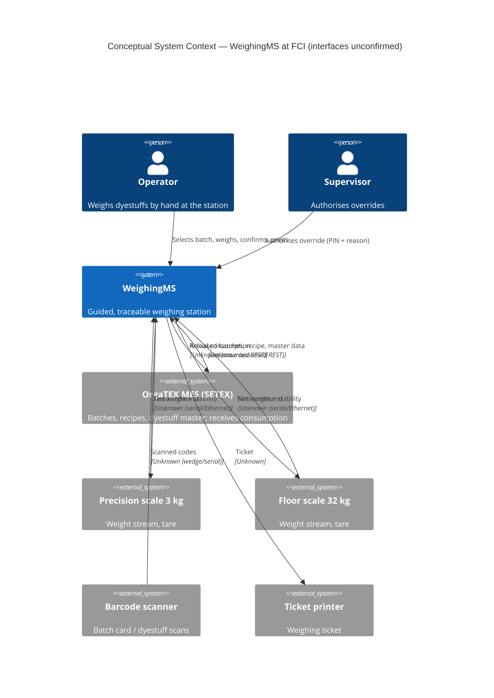
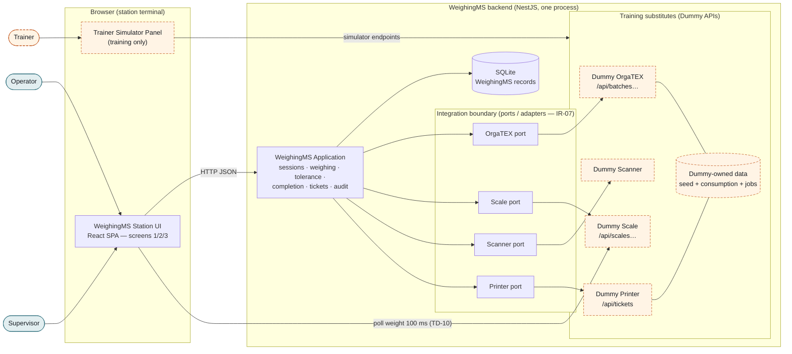

# Assisted Dyestuff Weighing Station - System Context

## System Overview

**WeighingMS** is a single-station operator terminal that sits between **OrgaTEX** (FCI's MES — owner of batches and recipes) and the **weighing operator**. It pulls the released batch queue and recipe, guides manual dispensing on the correct scale against target and tolerance, records every weighing immutably, writes actual consumption back to OrgaTEX, and prints a ticket that travels with the container.

This document separates two views:

1. **Conceptual context** — the real world the product is designed for (FCI dyehouse). Real interfaces are **unknown** (brief A-01, A-02, A-05, A-10, A-04).
2. **Training context** — what is actually built and run in this lab: every external system and device is replaced by a **Dummy implementation hosted inside the WeighingMS backend**, behind the same adapter boundary a real integration would use.

Sources: approved `requirements.md` (FR-1…FR-34, NFR-1…NFR-14, TD-1…TD-10, DB-1…DB-8), `ui-analysis.md`, `docs/brief.md` §9–§10, §13.

---

## Actors

### Human actors

| Actor | Type | Interacts via | Responsibilities | Req |
|-------|------|---------------|------------------|-----|
| **Operator** | Primary human user | Station touchscreen + F-keys; scanner | Select batch, weigh components, Re-tare, Quit, confirm, complete batch, print ticket, move to next batch | FR-1…FR-25, FR-33 |
| **Supervisor** | Privileged human user | Station touchscreen (PIN + reason dialog) | Authorise out-of-tolerance confirmation (override) | FR-19, TD-7 |
| *Trainer / lab participant* | **Training-only** human actor | Trainer simulator panel (separate from station screen) | Drive Dummy devices: simulate dispense/overshoot, set weight, take devices offline, inject scans, reset scenario | FR-34, DB-4, DB-8 |

Indirect stakeholders (no UI in this build): Lab/QA and Store/inventory consume the weighing record and consumption via OrgaTEX.

### Systems

| System | Role | Owner | Real interface | Training substitute |
|--------|------|-------|----------------|---------------------|
| **WeighingMS** | System being built | Project team | — | — (real product code) |
| **OrgaTEX** (SETEX MES) | Upstream source of batches, recipes, dyestuff master; downstream recipient of actual consumption | FCI / SETEX | **Unknown** — brief assumes REST/JSON (A-01, OQ-01) | **Dummy OrgaTEX API** (DB-1, DB-2, DB-7) |

### Devices

| Device | Role | Real interface | Training substitute |
|--------|------|----------------|---------------------|
| **Precision scale** (3 kg, 0.1 g) | Weighs components with target ≤ 3 000 g (TD-3) | **Unknown** — assumed continuous ≥10 Hz stream with stability flag over serial/Ethernet (A-05, OQ-04) | **Dummy Scale API** `scale-3kg` (DB-3, DB-4) |
| **Floor scale** (32 kg, 0.001 kg) | Weighs components with target > 3 000 g | as above | **Dummy Scale API** `scale-32kg` |
| **Barcode scanner** | Batch-card and dyestuff identity scans | **Unknown** — assumed keyboard-wedge or serial (A-10) | **Dummy Scanner** (DB-5) + keyboard-wedge entry |
| **Ticket printer** | Prints weighing ticket with barcode | **Unknown** — model, label language, layout (A-04, OQ-12) | **Dummy Printer** (DB-6) |
| Station terminal | 15" industrial touchscreen with function keys | Browser on terminal | Browser on laptop; F-keys from keyboard |

---

## Context Diagrams

### A. Conceptual context (real world — interfaces unconfirmed)

### B. Training context (what is built and run)

Dashed orange = exists only for training; would be **removed** (not modified) when a real integration replaces it.

---

## External Integrations

- **OrgaTEX** — read released batch queue, batch detail, recipe/components (with targets, tolerances, lots, containers, dyestuff master); write actual consumption on batch completion. Training: Dummy OrgaTEX (DB-1, DB-2).
- **Scales (2)** — read net weight + stability + status continuously; send tare. Training: Dummy Scale with simulator (DB-3, DB-4).
- **Scanner** — receive batch-card and dyestuff barcode scans. Training: Dummy Scanner + keyboard-wedge (DB-5).
- **Printer** — submit weighing ticket, receive job status. Training: Dummy Printer (DB-6).

---

## Data Flows

### Inbound (into WeighingMS)

| From | Data | Format (training) | Validation by WeighingMS | Req |
|------|------|-------------------|--------------------------|-----|
| OrgaTEX | Batch queue: batchId, orderRef, machineRef, fabricDesc, fabricWeightKg, shadeCode, componentCount, status | JSON via `GET /api/batches` | Required fields present; status enum; only RELEASED selectable | FR-1, FR-3, TD-1 |
| OrgaTEX | Batch detail | JSON via `GET /api/batches/:batchId` | Batch exists (404 → "not found") | FR-2 |
| OrgaTEX | Recipe: components (sequence, dyestuff code/name/colour/barcode, target, uom, tolerance, display max, lot, container + tare) | JSON via `GET /api/batches/:batchId/recipe` | Quantities as integer mg; tolerance ≥ 0; sequence unique | FR-5, FR-6, FR-8–FR-10 |
| Scale | Net weight, stable flag, scale status, timestamp | JSON via `GET /api/scales/:scaleId/weight` (polled 100 ms) | Reject negative / non-numeric / > capacity → INVALID READING; offline → SCALE OFFLINE | FR-13, FR-29, FR-30 |
| Scale | Scale list and status | JSON via `GET /api/scales`, `/:scaleId/status` | — | FR-12, FR-28 |
| Scanner | Scanned code (batch card or dyestuff barcode) | Scan events from Dummy Scanner; keyboard-wedge text + Enter | Classified as batch vs dyestuff; batch → FR-2/FR-3; dyestuff → identity check | FR-2, FR-7 |
| Printer | Job id, job status, rendered ticket | JSON response of `POST /api/tickets` | — | FR-25 |
| Operator | Touches / F-keys: select, confirm, re-tare, quit, next batch, print | UI events → WeighingMS API | Server re-validates confirmation (422 OUT_OF_TOLERANCE) and completion (409 BATCH_INCOMPLETE) | FR-17, FR-23, FR-33 |
| Supervisor | PIN + reason | UI dialog → WeighingMS API | PIN matches seeded supervisor (hashed); reason non-empty | FR-19, NFR-11 |

### Outbound (from WeighingMS)

| To | Data | Format (training) | Guarantee | Req |
|----|------|-------------------|-----------|-----|
| OrgaTEX | Actual consumption per component: dyestuff, lot, target, actual, uom, scale, result, operator, completion time, **idempotency key = session id** | JSON via `POST /api/batches/:batchId/consumption` | **Exactly-once effect** (idempotent); on failure local completion + PENDING + manual Retry | FR-24, NFR-10, TD-8 |
| Scale | Tare command | `POST /api/scales/:scaleId/tare` | Net reading 0 after success | FR-10, FR-11 |
| Printer | Ticket: batch, order, machine, shade, date, operator, component target/actual lines, tolerance summary, Code 128 barcode of batch id | JSON via `POST /api/tickets` | Preview always available; print failure → error + Retry | FR-25, TD-9 |
| Operator / Supervisor | Screens 1/2/3, live weight, zones, status strip, summary, ticket preview | HTML/SPA | Live weight ≤ 200 ms; recipe ≤ 3 s | NFR-1, NFR-2 |

### Internal persistence (WeighingMS-owned)

Weighing sessions, immutable weighing records (target/tolerance snapshots, actual, lot, container, tare, scale, operator, result, timestamp), overrides, audit events (`OVERRIDE`, `ABANDON`, `REPRINT`), write-back status, ticket references — SQLite (`data-stack.md`).

---

## Data Ownership

| Data | Owner (master) | WeighingMS role | Training location |
|------|----------------|-----------------|-------------------|
| Batch header & queue | OrgaTEX | Read-only (shows local session state WEIGHING) | Dummy OrgaTEX tables (seed) |
| Recipe, components, targets, tolerances | OrgaTEX | Read-only; **snapshot** on each weighing record | Dummy OrgaTEX tables (seed) |
| Dyestuff master (code, name, colour, barcode) | OrgaTEX | Read-only | Dummy OrgaTEX tables (seed) |
| Dyestuff lot (per component) | OrgaTEX (training: seeded, TD-5) | Read; recorded on weighing | Dummy OrgaTEX tables (seed) |
| Container master + tare | WeighingMS (brief §9.3) | Master | Seed (WeighingMS tables) |
| Scale configuration (id, class, capacity, resolution) | WeighingMS | Master | Seed (WeighingMS tables) |
| Scale live state (weight, stable, online) | Scale device | Read | Dummy Scale in-memory state |
| Operator & supervisor identities | WeighingMS (training seed, TD-6/TD-7) | Master | Seed (WeighingMS tables) |
| Weighing sessions, records, overrides, audit | **WeighingMS** | Master, immutable once confirmed | WeighingMS tables |
| Actual consumption (received) | OrgaTEX | Write via API only | Dummy OrgaTEX tables |
| Print jobs | Printer | Write via API only | Dummy Printer tables |

Rule (C-01, C-02): WeighingMS never writes OrgaTEX-owned data except through the consumption API, and never reads a Dummy's tables directly — always through its port/adapter.

---

## Integration Boundaries

| Boundary | Inside WeighingMS (product code) | Outside (replaceable) | Contract status |
|----------|-----------------------------------|-----------------------|-----------------|
| **OrgaTEX port** | `OrgatexPort` interface: listBatches, getBatch, getRecipe, postConsumption | Dummy OrgaTEX adapter → future real adapter (REST/OPC-UA/DB/file) | **Training contract only** (workbook paths); real contract unknown (OQ-01, OQ-02) |
| **Scale port** | `ScalePort`: listScales, getStatus, readWeight, tare | Dummy Scale adapter → future serial/Ethernet driver | Training contract only (OQ-04) |
| **Scanner port** | `ScannerPort`: scan events; plus keyboard-wedge input in UI | Dummy Scanner → future device | Training contract only |
| **Printer port** | `PrinterPort`: submitTicket, jobStatus | Dummy Printer → future label printer driver | Training contract only (OQ-12) |
| UI ↔ WeighingMS API | Typed HTTP client (`src/client/api/`) — the only place the UI calls the network | — | Internal contract (defined in design) |

Exception noted: the UI polls the Dummy Scale weight endpoint directly (TD-10, workbook Step 21). In a real deployment this read would go through a WeighingMS endpoint backed by the Scale port; the client hook isolates this so the path can change without UI changes.

Dummy APIs are hosted in the same NestJS process under `/api/…` and the simulator controls under a separate training prefix, so they are clearly not part of the station UI.

---

## Failure Boundaries

| Failure | Detected by | Contained where | Station behaviour (safe state) | Never happens | Req |
|---------|-------------|-----------------|-------------------------------|---------------|-----|
| **Scale offline / not responding** | Weight poll error or `status: offline`; ≤ 2 s | Scale port / client weight hook | `SCALE OFFLINE`, strip red, OK disabled; resumes on recovery | A reading taken while offline is recorded | FR-29, IR-13 |
| **Invalid reading** (negative, NaN, > capacity) | Validation of each reading | Weighing domain | `INVALID READING`, OK disabled | Invalid value confirmed | FR-30 |
| **Unstable reading** | `stable: false` | Weighing domain | Shown, OK disabled | Confirmation while unstable | FR-13, FR-17 |
| **OrgaTEX unavailable — queue/recipe load** | 503 / timeout from OrgaTEX port | Batch selection | "OrgaTEX unavailable — Retry"; no stale or invented data | Weighing a batch whose recipe was not loaded | FR-31 |
| **OrgaTEX unavailable — write-back** | 503 / timeout on consumption post | Completion / write-back | Batch completed locally; `PENDING` + Retry; idempotent | Duplicate consumption; lost weighings | FR-24, TD-8, NFR-10 |
| **Printer unavailable** | 503 from printer port | Ticket | Preview shown; "Printer unavailable" + Retry; completion not blocked | Ticket content lost | FR-25, FR-32, TD-9 |
| **Scanner unavailable** | Scanner status offline | Scanner port | Strip shows it; touch selection still works | Operator blocked | FR-32 |
| **Wrong dyestuff scanned** | Identity check | Weighing domain | Mismatch error; OK blocked until correct scan or Quit | Wrong dyestuff confirmed after mismatch | FR-7 |
| **Out-of-tolerance confirm attempt** (e.g. stale UI) | Server re-validation | Weighing domain | `422 OUT_OF_TOLERANCE` shown | Out-of-tolerance record without override | FR-17 |
| **Premature completion** | Server check | Session domain | `409 BATCH_INCOMPLETE` | Batch completed with pending components | FR-23 |
| **Override auth failure** | PIN / reason check | Override domain | "Supervisor authentication failed" / "Reason is required" | Override without supervisor + reason | FR-19 |
| **Browser reload / crash** | Session state on server | Session domain | Resume at active component | Loss of confirmed weighings | NFR-6, NFR-7 |

Each Dummy can be failed independently (DB-7), so every row above is demonstrable (workbook Step 30).

---

## High-Level Constraints

- OrgaTEX remains source of truth for batches and recipes; recipes read-only (C-01, C-02, BR-04).
- No connection to or control of dispensing machinery (C-03).
- No real external contracts are invented; Dummy contracts are labelled training-only.
- Single station, single active session, runs locally on one machine (A-11, tech-stack).
- UI receives all data via APIs; no scenario data in UI code (workbook Rule 5).

## Key NFR Goals

- Live weight latency ≤ 200 ms; recipe displayed ≤ 3 s (NFR-1, NFR-2).
- Exact integer-mg arithmetic; immutable, durable weighing records (NFR-7–NFR-9).
- Idempotent OrgaTEX write-back (NFR-10).
- Safe failure for every device and OrgaTEX outage (failure boundaries above).
- Deterministic seed/reset for demos and tests (NFR-12).

## Completeness Check

- Third-party integrations missed? None beyond OrgaTEX, 2 scales, scanner, printer. The **21-key terminal** is treated as keyboard F-keys (FR-33), not a separate integration.
- Legacy systems? None — current process is paper (A-13).
- Future integrations (not in this build): offline sync to OrgaTEX (deferred), OrgaTEX batch status update (IR-06), multi-station supervisor view (BR-22), reporting (BR-23), calibration source (BR-24).
