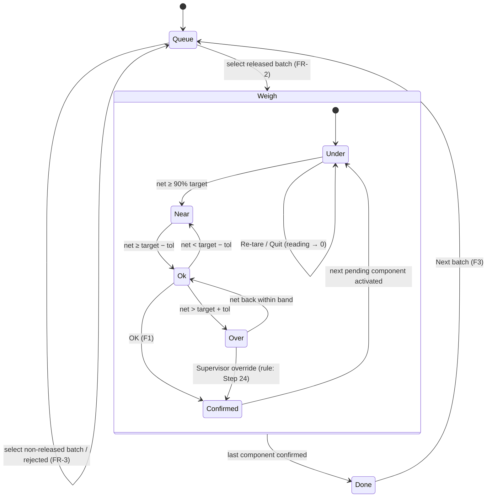

# UI/UX Analysis: WeighingMS Operator Terminal Prototype

Analysis of `docs/customize-weighing-station.html` as a **functional prototype** (workbook Step 8). No redesign and no code. Line references (`L123`) point to the prototype file. Requirement references (`FR-n`, `NFR-n`, `TD-n`, `DB-n`) point to the approved `requirements.md`.

Prototype composition: one HTML file — CSS tokens and layout (L3–L407), markup (L409–L671), one IIFE script (L673–L870). No framework, no network calls; **all data is hard-coded** (L459–L484, L571–L610, L677–L683).

---

## 1. Screen Inventory

| # | Screen | Element | Lines | Purpose | Reached by (prototype) | Reached by (product) |
|---|--------|---------|-------|---------|------------------------|----------------------|
| S0 | **Station frame** (persistent) | `.device > .screen` | L437–L630 | 15" industrial touch terminal: top bar + active view + status strip | Always visible | Always visible |
| S1 | **1 · Select batch** | `#v-queue` | L448–L487 | Scan prompt + batch queue table | Screen switcher button (L425) | App start; "Next batch" (F3) |
| S2 | **2 · Weigh** | `#v-weigh` | L490–L564 | Recipe rail + guided weighing panel | Default active view (L490 `active`), switcher (L426) | Selecting a released batch (FR-2) |
| S3 | **3 · Confirm & print** | `#v-done` | L567–L616 | Completion summary, OrgaTEX write-back status, ticket preview | After last component confirmed (L820), switcher (L427) | All components done (FR-23) |
| X1 | Demo controls (not product) | `.controls` | L422–L434 | Screen switcher, Simulate dispense/overshoot, Reset, pins toggle | — | **Becomes trainer simulator panel** (FR-34); screen switcher dropped |
| X2 | Meeting notes (not product) | `.notes`, `footer` | L633–L670 | Facilitation notes + pinned-question list | — | Not built |

Device chrome: bezel label "15" INDUSTRIAL TOUCH TERMINAL" (L155–L159); screen min-height 660 px (L164); dark HMI palette constant across page themes (L4–L6, L18–L30).

---

## 2. UI Component Inventory

| Component | Screen | Lines | Contents | Notes / Req |
|-----------|--------|-------|----------|-------------|
| Brand mark | S0 top bar | L441 | `WeighingMS` + `STATION 01` | FR-4 |
| Batch crumb | S0 top bar | L442 | `BATCH · ORDER · MACHINE` | Static B-24187 in prototype → dynamic (FR-4) |
| Operator chip | S0 top bar | L444 | green dot, `Operator R. Karim · Shift A` | Static → session operator (TD-6) |
| Scan prompt | S1 | L450–L456 | animated scan beam (L335–L338), "Scan a batch card to begin", "Queue received from OrgaTEX at 06:12" | FR-1, FR-2 |
| Batch queue table | S1 | L458–L484 | cols Batch, Order, Machine, Fabric / lot, Shade, Comp., Status; selected row highlight `tr.sel`; status tag `.tag` / `.tag.now` | FR-1 |
| Recipe rail header | S2 | L494–L498 | `Recipe · Teal 4C`, batch id, `{n} of 5 components weighed` | FR-5 |
| Component row (`.comp`) | S2 rail | L696–L716, CSS L209–L225 | swatch colour, name, `code · scale`, target qty+unit, state text (`✓ actual` / `WEIGHING` / `PENDING`); `data-state` styling | FR-5, FR-22 |
| Component header | S2 | L504–L507 | name; meta `code · LOT · CONTAINER · TARE` | FR-6, FR-8–FR-10 |
| Scale badge | S2 | L508–L512 | `SCALE SELECTED` / scale name / `automatic` | FR-12 |
| Readout — Weighed now | S2 | L516–L519 | 52 px live value + unit, zone colour | FR-13, NFR-4 |
| Readout — Still to weigh | S2 | L520–L523 | 30 px value + unit | FR-15 |
| Readout — Target | S2 | L524–L527 | 30 px value + unit | FR-14 |
| Progress bar | S2 | L531–L535 | fill, tolerance band, target line; `role="progressbar"` + aria values | FR-16, NFR-5 |
| Bar caption | S2 | L536–L540 | `0` · `TOLERANCE ±x u (lo – hi)` · display max | FR-16 |
| Status line | S2 | L541 | zone-coloured instruction text | FR-16 |
| Surplus panel | S2 | L544–L554 | over-tolerance heading, recalculation table, proposal text | FR-21 (rule pending Step 24) |
| Action keys | S2 | L556–L561 | `OK · Confirm F1` (green, disabled by default), `Re-tare F2`, `Quit F4`, `Supervisor override` | FR-17, FR-11, FR-20, FR-19; NFR-3 (min 62×150 px, L300) |
| Completion message | S3 | L570 | `Batch B-24187 weighed` | FR-23 |
| Summary list | S3 | L571–L578 | Components weighed, All within tolerance, Total dispensed, Elapsed, Operator, Written to OrgaTEX | FR-23, FR-24 |
| S3 actions | S3 | L583–L586 | `Print ticket F1`, `Next batch F3` | FR-25, FR-33 |
| Ticket preview | S3 | L590–L610 | paper-style ticket: header, batch/order/machine/shade/date/operator, component TGT/ACT lines, tolerance line, barcode, batch id | FR-25 |
| Status strip | S0 bottom | L618–L627 | `SCALE 3 kg · READY`, `SCALE 32 kg · READY`, `SCANNER`, `PRINTER`, `ORGATEX · LINKED 07:41` (amber dot), `EN`, clock | FR-28 |
| Question pins | various | L377–L385, e.g. L444, L454 | numbered pins with brief questions | Meeting aid — not built |

Design tokens worth preserving (UX reference): zone colours `--ok #2fbf6b`, `--warn #f0a726`, `--over #e8503a`, `--steel #5b8cc4` (L27–L30); monospace tabular numerals for all quantities (L246–L249).

---

## 3. User Actions

| Action | Where | Lines | Prototype effect | Product behaviour (req) |
|--------|-------|-------|------------------|-------------------------|
| Scan batch card | S1 | L450–L456 | None (visual only) | Select batch (FR-2) via Dummy Scanner |
| Touch queue row | S1 | L463–L482 | **None — no handler** | Select batch (FR-2) / reject (FR-3) |
| Touch component row | S2 rail | L711, L718–L724 | If not done: make active, reset reading | Same; done rows locked (FR-22) |
| Dispense (pour) | physical | — | Simulated by buttons (L802–L809) | Dummy Scale simulator (DB-4, FR-34) |
| OK · Confirm (F1) | S2 | L814–L822 | Store actual, mark done, auto-advance or go to S3 | FR-17, FR-18, FR-22, FR-23 |
| Re-tare (F2) | S2 | L811 | Same as Reset: reading → 0 | Tare command + reset (FR-11) |
| Quit (F4) | S2 | L812 | Same as Reset: reading → 0 | Abandon, audit event (FR-20) |
| Supervisor override | S2 | L824–L826 | Status text "OVERRIDE REQUESTED — AWAITING SUPERVISOR" | PIN + reason → OVERRIDDEN (FR-19) |
| Print ticket (F1) | S3 | L584 | **None — no handler** | Dummy Printer (FR-25) |
| Next batch (F3) | S3 | L585 | **None — no handler** | Return to S1 (FR-23) |
| Function keys F1/F2/F3/F4 | all | labels L557–L559, L584–L585 | **No keyboard handlers** | FR-33 |
| Demo: Simulate dispense | X1 | L802–L805 | Ramp to target + 0.4×tol | Trainer panel (FR-34) |
| Demo: Simulate overshoot | X1 | L806–L809 | Ramp to target + 4.8×tol | Trainer panel (FR-34) |
| Demo: Reset | X1 | L810 | Reading → 0 | Scenario reset (DB-8, NFR-12) |
| Demo: screen switcher | X1 | L837–L839 | Jump to any view | Not built (navigation is state-driven) |
| Demo: pins toggle | X1 | L842–L845 | Show/hide question pins | Not built |

---

## 4. Application States

| State machine | Values | Lines | Representation |
|---------------|--------|-------|----------------|
| **View** | `queue` · `weigh` · `done` | L829–L836 | `.view.active`; switcher `aria-pressed` |
| **Component** | `pending` · `active` · `done` | L678–L682 (`state`), L720 | `data-state` on rail rows (L216–L225) |
| **Weight zone** | `under` · `near` · `ok` · `over` | L729–L735 | `data-zone` on live cell, bar, status line (L252–L282) |
| **Confirm button** | enabled · disabled | L779 | enabled iff zone = `ok` |
| **Surplus panel** | hidden · shown | L778 | shown iff zone = `over` |
| **Simulation** | idle · ramping | L783–L800 | `timer` interval (34 ms) |
| Override request | none · requested | L824–L826 | status text only; overwritten by next repaint |
| Device/link status | ready (green) · warning (amber) | L619–L623 | static dots |
| Pins | on · off | L842–L845 | body class |

**States missing from the prototype but required** (FR-2/3, FR-7, FR-19, FR-24, FR-25, FR-28–FR-32): batch rejected; identity verified/mismatch; reading unstable; scale offline; invalid reading; override dialog (PIN/reason) and overridden result; OrgaTEX write-back pending/confirmed/failed; print in progress/failed; OrgaTEX unavailable on queue/recipe load; scanner/printer offline.

### State model (view + component + zone)

Component lifecycle: `pending → active` (auto-advance or touch) → `done` (confirm). `active → pending` when another pending row is touched (L720). `done` is terminal (L719).

---

## 5. Data Displayed

| Datum | Screen | Lines | Format |
|-------|--------|-------|--------|
| Station name | S0 | L441 | `STATION 01` |
| Batch id, order, machine | S0, S1, S3 | L442, L464, L593–L595 | mono text |
| Operator name, shift | S0, S3 | L444, L576, L598 | text |
| Queue fetch time | S1 | L454 | `HH:MM` |
| Fabric description · fabric weight | S1 | L465 | `100% CTN knit · 480 kg` |
| Shade | S1, S2, S3 | L465, L495, L596 | text |
| Component count | S1 | L465 | integer |
| Batch status | S1 | L466 | tag `WEIGHING` / `QUEUED` |
| Weighed count | S2 | L497 | `n of N` |
| Component name, code, colour, scale | S2 | L705–L710 | swatch + text |
| Component target, actual | S2, S3 | L708–L709, L601–L605 | g 1 dp / kg 3 dp (L692–L693) |
| Lot, container, tare | S2 | L741–L743 | `LOT 2026-0387 · CONTAINER C-12 · TARE 214.0 g` |
| Scale name | S2 | L744 | `3 kg precision` / `32 kg floor` |
| Live net weight | S2 | L746 | unit-formatted |
| Still to weigh | S2 | L747 | max(0, target − now) |
| Tolerance ±, band lo–hi | S2 | L763–L765 | unit-formatted |
| Display max | S2 | L766 | unit-formatted |
| Status message | S2 | L770–L776 | see §10 |
| Surplus amount / % / recalculated targets | S2 | L545–L549 | static text |
| Summary: weighed n/N, all-in-tolerance, total dispensed, elapsed, operator, OrgaTEX write-back time | S3 | L572–L577 | static text |
| Ticket fields | S3 | L591–L609 | mono, 52-bar pseudo-barcode (L848–L856) |
| Device statuses, OrgaTEX link time, language, clock | S0 | L619–L626 | dots + text |

## 6. Data Required (to drive the screens from APIs)

| Entity | Fields needed | Source (product) | Prototype origin |
|--------|---------------|------------------|------------------|
| Station | id, name | WeighingMS config | L441 |
| Operator / supervisor | id, name, shift, role, (supervisor) PIN hash | Seed identities (TD-6, TD-7) | L444 |
| Batch | batchId, orderRef, machineRef, fabricDesc, fabricWeightKg, shadeCode, componentCount, status | Dummy OrgaTEX `GET /api/batches`, `/:batchId` | L459–L484 |
| Recipe | recipeId, shade, components[] | Dummy OrgaTEX `GET /api/batches/:batchId/recipe` | L677–L683 |
| Recipe component | componentId, sequence, dyestuff code, name, colourHex, barcode, targetQty, uom, toleranceQty, displayMaxQty, lotId, containerId | Dummy OrgaTEX recipe + master data (seed) | L678–L682 |
| Container | containerId, tareQty | Container master (seed, TD-4) | `cont`, `tare` |
| Scale | scaleId, class, capacity, resolution, status | Dummy Scale `GET /api/scales`, `/status` | L510, L619–L620 |
| Weight reading | scaleId, netQty, stable, status, timestamp | Dummy Scale `GET /api/scales/:id/weight` | `now` (L686) |
| Weighing session | sessionId, batchId, operatorId, startedAt, completedAt, status | WeighingMS | implicit (elapsed L575) |
| Weighing record | componentId, actual, lot, container, tare, scale, target/tol snapshot, result, operatorId, confirmedAt | WeighingMS | `actual` (L816) |
| Consumption write-back | status, confirmedAt | Dummy OrgaTEX `POST .../consumption` | L577 |
| Ticket / print job | ticketId, content, barcode value, job status | Dummy Printer `POST /api/tickets` | L590–L610 |
| Device status | per device online/offline, OrgaTEX link time | Dummy APIs status | L618–L626 |

Derived (computed, not stored as input): zone, remaining, progress %, band position, weighed count, all-within-tolerance, total dispensed, elapsed.

---

## 7. State Transitions

| # | From | Event | Guard | To | Side effects | Lines |
|---|------|-------|-------|----|--------------|-------|
| T1 | S1 | touch/scan batch | batch RELEASED | S2 | load batch + recipe; start session; first pending active | (none in prototype) — FR-2 |
| T2 | S1 | touch/scan batch | not released / unknown | S1 | show reason | FR-3 |
| T3 | S2 component pending | touch row | row not done | active | previous active → pending; reading → 0 | L718–L724 |
| T4 | S2 any zone | weight change | — | zone recomputed | repaint readouts, bar, status, surplus, OK | L737–L780 |
| T5 | S2 zone ok | OK (F1) | zone ok | component done | record actual; next pending active **or** → S3 | L814–L822 |
| T6 | S2 | Re-tare (F2) | — | reading 0 | (product: tare command) | L811 |
| T7 | S2 | Quit (F4) | — | reading 0 | (product: abandon + audit) | L812 |
| T8 | S2 | Supervisor override | — | "override requested" | (product: PIN + reason) | L824–L826 |
| T9 | S2 last component | OK | all done | S3 | (product: complete session, post consumption) | L820 |
| T10 | S3 | Print ticket | — | S3 | (product: printer job) | L584 |
| T11 | S3 | Next batch | — | S1 | (product: refresh queue) | L585 |

Note: after T5 the next component is the **first pending by index** (L818), not the next after the current one.

---

## 8. Validation Behaviour

| Rule | Lines | Prototype | Product |
|------|-------|-----------|---------|
| Confirm only in tolerance | L779 | `btn-ok.disabled = (zone !== "ok")` | FR-17 (+ stable, scale online, no identity mismatch; server re-validates) |
| Tolerance boundaries inclusive | L731–L732 | `> target+tol` over; `>= target−tol` ok | FR-16 (93.5 ✓ / 94.5 ✓ / 94.6 ✗) |
| Done component cannot be reselected | L719 | early return | FR-22 |
| Batch completes only when no pending | L818–L820 | `findIndex(pending) === -1` | FR-23 (+ API `409 BATCH_INCOMPLETE`) |
| Remaining never negative | L747 | `Math.max(0, …)` | FR-15 |
| Band always visible | L760 | min width 0.6 % | UX detail |
| Progress capped at 100 % | L751 | `Math.min(100, …)` | UX detail |
| **Not validated in prototype**: batch status, identity scan, stability, scale offline, invalid/negative reading, capacity, override authentication/reason | — | — | FR-3, FR-7, FR-13, FR-29, FR-30, FR-19 |

---

## 9. Integration Points

| Point | UI evidence | Lines | Dummy API (requirements) |
|-------|-------------|-------|--------------------------|
| OrgaTEX batch queue | "Queue received from OrgaTEX at 06:12" | L454 | `GET /api/batches` (DB-1) |
| OrgaTEX batch + recipe | rail, crumb, component data | L442, L495, L677–L683 | `GET /api/batches/:batchId`, `/recipe` (DB-1) |
| OrgaTEX write-back | "Written to OrgaTEX · CONFIRMED 07:48:22"; "Actual consumption posted against the batch" | L577, L580 | `POST /api/batches/:batchId/consumption` (DB-2) |
| OrgaTEX link status | `ORGATEX · LINKED 07:41` | L623 | Dummy status (DB-7) |
| Scale live weight | Weighed now | L516–L519 | `GET /api/scales/:scaleId/weight` (DB-3) |
| Scale selection / status | badge, `SCALE 3 kg · READY`, `SCALE 32 kg · READY` | L510, L619–L620 | `GET /api/scales`, `/status` (DB-3) |
| Scale tare | Re-tare button, TARE in meta | L558, L742 | `POST /api/scales/:scaleId/tare` (DB-3) |
| Scanner | scan prompt, `SCANNER` status | L450–L453, L621 | Dummy Scanner (DB-5) |
| Printer | Print ticket, ticket preview, `PRINTER` status | L584, L590–L610, L622 | `POST /api/tickets` (DB-6) |
| Operator identity | operator chip | L444 | Seed identities (TD-6) |
| Supervisor authentication | override button | L560 | Seed supervisor PIN (TD-7) |

---

## 10. Business Rules Embedded in JavaScript

| # | Rule | Lines | Status in requirements |
|---|------|-------|------------------------|
| R1 | Zone classification: over if `v > target + tol`; ok if `v ≥ target − tol`; near if `v ≥ 0.9 × target`; else under | L729–L735 | Adopted (FR-16); 90 % = AS-3 |
| R2 | Confirm enabled iff zone ok | L779 | Adopted and strengthened (FR-17) |
| R3 | Display precision: kg → 3 dp, otherwise 1 dp | L692–L693 | Adopted (units convention) |
| R4 | Remaining = max(0, target − now) | L747 | Adopted (FR-15) |
| R5 | Progress % = now / display max; band = (target ± tol) / max; target line = target / max | L751–L761 | Adopted (FR-16); display max = AS-4 |
| R6 | Status text by zone: `DISPENSE — x u REMAINING` / `WITHIN TOLERANCE — PRESS OK TO CONFIRM` / `OVER TOLERANCE — SURPLUS +x u` | L770–L776 | Adopted verbatim (FR-16) |
| R7 | **Surplus = now − target** (not now − upper bound) | L771 | **Open — OQ-16, Step 24** |
| R8 | **Compensation proposal**: remaining components × (1 + surplus/target) — applied in the static panel only to Sodium Sulphate and Soda Ash (24.000 → 24.624 kg, 9.600 → 9.850 kg; factor ≈ 1.026 = 96.4/94.0) | L545–L552 | **Open — OQ-07, Step 24; must not be copied** (WB Step 24) |
| R9 | Scale per component is a fixed attribute (no threshold logic) | L678–L682 | Replaced by rule TD-3 (≤ 3 000 g → precision) — consistent with prototype data |
| R10 | Unit follows component (`g` / `kg`) | L678–L682, L749 | Adopted (FR-12) |
| R11 | Selecting a pending component abandons the current reading silently | L720–L722 | Adopted for touch; Quit now audited (FR-20) |
| R12 | Auto-advance to first pending component after confirm; go to S3 when none | L818–L821 | Adopted (FR-22, FR-23) |
| R13 | Actual recorded = reading at the moment of OK | L816 | Adopted (FR-18) |
| R14 | Simulated pour: 34 ms tick, step = max(0.4 % target, 5.5 % remaining); in-tolerance landing = target + 0.4×tol; overshoot landing = target + 4.8×tol | L787–L809 | Training-only (DB-4) |
| R15 | Reduced motion → jump straight to landing value | L690, L791 | Adopted (NFR-5) |

---

## 11. Assumptions Represented by the Prototype

| # | Assumption | Evidence | Mapped to |
|---|------------|----------|-----------|
| P1 | Weight can be read **continuously** from the indicator | note L645–L648; pin 16 (L517) | brief A-05; DB-3/DB-4 |
| P2 | "Surplus compensation" means recalculating the remaining components | L551–L552; note L646 | brief A-08; **Step 24** |
| P3 | One operator weighs **one component at a time** against an OrgaTEX-owned queue | note L647 | FR-2, FR-22 |
| P4 | Scale is selected automatically (3 kg precision vs 32 kg floor) | L510–L511 | brief A-06; TD-3 |
| P5 | Tolerance is an absolute ± per component | L678–L682 `tol` | brief A-07; AS-1 |
| P6 | One container per component with a known tare (reusable containers share 214 g / 1.850 kg) | L678–L682 | TD-4 |
| P7 | Lot is known before weighing | L678–L682 `lot` | TD-5 |
| P8 | Operators are identified individually, by shift | L444 | brief A-09; TD-6 |
| P9 | Interface language is English | L625 | brief A-10 |
| P10 | A ticket printer exists; ticket content is invented | L611–L612 | brief A-04; FR-25 |
| P11 | Write-back to OrgaTEX happens at batch completion and succeeds | L577–L581 | brief A-02; FR-24, TD-8 |
| P12 | Station is a 15" touch terminal with F-keys (F1 OK, F2 Re-tare, F3 Next, F4 Quit) | L155–L157, L557–L585 | IR-17; FR-33 |
| P13 | All values (summary, ticket, surplus panel, queue time, clock, link time) are illustrative, not computed | L545–L549, L571–L610, L858–L865 | Product computes them (FR-23, FR-25) |

---

## 12. Questions the Prototype Cannot Answer

| # | Question | Prototype evidence | Status |
|---|----------|--------------------|--------|
| UQ-1 | What does the amber dot on `ORGATEX · LINKED 07:41` mean (stale? degraded?) when other devices are green? | L623 `dot warnd` | **New** — Training: green = linked, red = unavailable (FR-28) — confirmed |
| UQ-2 | What happens after "Supervisor override" — who, how authenticated, what is recorded? | L824–L826 only sets text | Closed for training by TD-7; overshoot interaction → Step 24 |
| UQ-3 | Surplus: measured from target or from upper bound? Applied to which components? Why are only auxiliaries recalculated after a dye overshoot? | L545–L552, L771 | **OQ-07 / OQ-16 → Step 24** |
| UQ-4 | What happens when the overshoot cannot be compensated? | none | **OQ-07 → Step 24** |
| UQ-5 | Is the queue row selectable at all, and which statuses are selectable? | no handler; `WEIGHING`/`QUEUED` only | Closed by TD-1 |
| UQ-6 | How is a batch-card scan distinguished from a dyestuff scan? | scan prompt only | Design decision (DB-5) |
| UQ-7 | What exactly does Re-tare do vs Quit? Both just reset | L811–L812 | Closed by FR-11 / FR-20 |
| UQ-8 | What does the summary show when something was overridden, or write-back failed? | static `YES`, `CONFIRMED` | Closed by FR-23 / FR-24 / TD-8 |
| UQ-9 | Where does the progress-bar maximum come from (125 g, 1600 g, 32 kg, 14 kg)? | L678–L682 `max` | AS-4 (seed field) |
| UQ-10 | Why is Blue RSPL's internal id `DYE-4471-B` while its code is `DYE-1180` (and Yellow shares `DYE-4471`)? | L678, L680 | Data inconsistency — training seed uses code `DYE-1180` |
| UQ-11 | Is stability required before confirmation? | no stability concept | Closed by FR-17 (stable required) |
| UQ-12 | Ticket barcode symbology and label layout | L608, L611–L612 pin 18 | Open — brief Q18 / OQ-12; Training: Code 128 of batch id — confirmed |
| UQ-13 | Does the station return to the queue automatically after printing? | Next batch has no handler | Closed: manual via Next batch (F3) |
| UQ-14 | Time zone/clock source for the date on the ticket and "CONFIRMED" time | clock simulated from 07:47:03 (L858–L865) | Training: server local time |

### Hard-coded / non-functional parts the product must make real

Queue rows (L463–L482), crumb (L442), operator (L444), queue time (L454), summary (L572–L577), ticket body (L593–L605), surplus panel (L545–L549), device strip (L619–L623), clock (L858–L865), Print ticket / Next batch / queue row / F-key handlers (absent). → All covered by FR-1…FR-34 and must come from APIs (workbook Rule 5).
